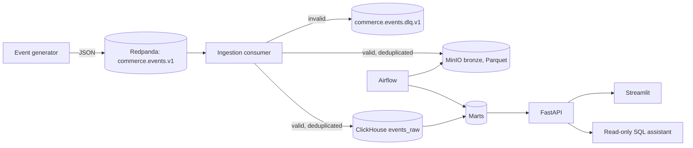

# CommercePulse

Streaming commerce analytics platform: Redpanda, MinIO (Parquet), ClickHouse, Airflow, with a read-only SQL assistant on top.

> **Status: design stage.** The architecture, storage conventions and the event contract (`src/commerce_pulse/common/events.py`) are written. Producers, consumers, storage, ClickHouse models, API, dashboard and the assistant are planned and not implemented yet. No benchmark has been run.
>
> All data in this project is synthetic.

## Business problem

An e-commerce team needs to see demand changes, stock risk and funnel conversion within minutes, and to keep every raw event for replay and audit.

## Architecture



Details: [architecture](docs/architecture.md), [data model](docs/data-model.md), [engineering decisions](docs/engineering-decisions.md).

## Delivery semantics

At-least-once with idempotent sinks. Not exactly-once. See `docs/architecture.md`.

## Stack

Python 3.12+, Redpanda, MinIO, Parquet, Polars, ClickHouse, Airflow, FastAPI, Streamlit, Docker Compose, pytest, ruff.

## Repository layout

```
src/commerce_pulse/  producers, consumers, ingestion, processing, storage,
                     analytics, quality, api, ai, common
sql/                 schemas and transformations
dags/                Airflow DAGs
dashboard/           Streamlit app
tests/               unit, integration, fixtures
docs/                design documents
```

## Run the existing tests

```bash
python -m venv .venv && source .venv/bin/activate
pip install -e ".[dev]"
pytest
ruff check .
```

Only the event contract tests exist at this stage.

## Planned work

Compose stack, generator and failure scenarios, consumer with DLQ and dedup, bronze writer, ClickHouse schemas and marts, API and dashboard, assistant with LLM via environment variables, benchmarks at 10k, 100k and 1M events.

## License

MIT
