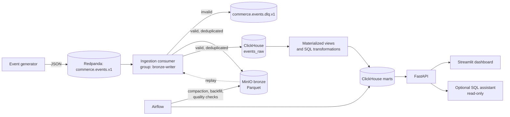

# Architecture

Status: Phase 1 design. Nothing below the event contract (`common/events.py`) is implemented yet.

## Data flow



## Layers

| Layer | Responsibility | Location |
|---|---|---|
| Generation | Synthetic events and failure scenarios | `producers/` |
| Streaming | Topics, consumer groups, DLQ | `consumers/`, `ingestion/` |
| Bronze | Immutable raw events in Parquet | `storage/` |
| Curated | ClickHouse tables and marts | `sql/`, `analytics/` |
| Serving | API, dashboard, assistant | `api/`, `dashboard/`, `ai/` |

## Delivery semantics

The pipeline is **at-least-once** end to end. It is not exactly-once.

- The consumer commits offsets only after the batch is durably written to bronze
  and ClickHouse. A crash between write and commit causes redelivery.
- Redelivery is made harmless by idempotent sinks: `event_id` is the dedup key in
  ClickHouse (`ReplacingMergeTree`) and bronze files are named deterministically
  from topic, partition and offset range, so a retried batch overwrites itself.
- `ReplacingMergeTree` deduplicates at merge time, not insert time. Queries that
  need exact counts must use `FINAL` or `argMax` patterns. This is a known cost.
- Cross-batch duplicates produced upstream (same `event_id`, different offsets)
  are caught by a bounded in-memory window in the consumer and by the table engine.
  Duplicates further apart than the window are only removed by the engine.

## Topics

| Topic | Key | Partitions | Retention |
|---|---|---|---|
| `commerce.events.v1` | `product_id`, falling back to `customer_id` | 6 | 7 days |
| `commerce.events.dlq.v1` | original key | 1 | 30 days |

Keying by `product_id` keeps all events for a product ordered within a
partition, which the inventory model relies on. The downside is hot partitions
during a demand spike on one product; that is deliberately one of the generator
scenarios so the effect can be measured.

## Bronze layout

```
bronze/events/
  event_type=<type>/
    event_date=<YYYY-MM-DD>/        # from event_timestamp, UTC
      ingest_date=<YYYY-MM-DD>/     # when the consumer wrote it
        part-p<partition>-o<first>-<last>.parquet
bronze/dead_letter/
  ingest_date=<YYYY-MM-DD>/
    part-p<partition>-o<first>-<last>.parquet
```

Each row keeps the original payload as a string column (`raw_payload`) next to
the parsed columns, plus `kafka_topic`, `kafka_partition`, `kafka_offset` and
`processed_at`. That is enough to replay a range of offsets or to re-parse
records after a schema change. Late events land in an old `event_date` partition
with a recent `ingest_date`, so incremental jobs select on `ingest_date`.

## Environment constraints for this build

The sandbox used to author the first phases has no running Docker daemon and no
package installation. Anything that needs Redpanda, ClickHouse, MinIO or
Airflow cannot be executed there. Documentation will mark each component as
verified or unverified once implementation starts.
